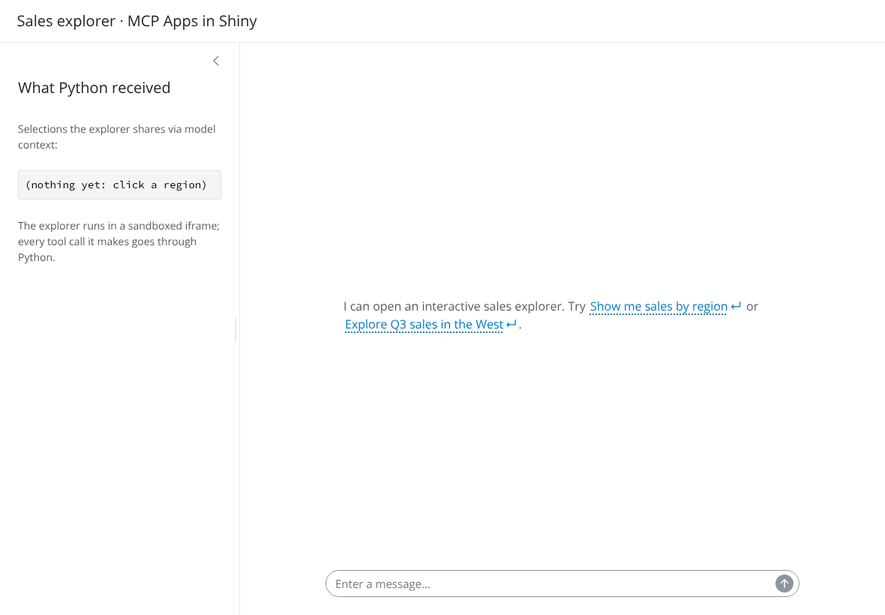

# shiny-mcp-host

**Turn MCP tool results into interactive apps in Shiny.** Embed an explorer in
a page or chat reply, and use the user's selections in your Python code.

[MCP Apps](https://github.com/modelcontextprotocol/ext-apps) are MCP tools that
come with an interactive HTML view. This package hosts them in Python Shiny
(`ui.Chat` included) and lets you write your own, all without Node.



## Try the demo

You need [uv](https://docs.astral.sh/uv/). No Node: the browser code ships prebuilt.

```bash
git clone https://github.com/mattmalcher/mcp-app-shiny.git
cd mcp-app-shiny
make setup   # Python environment from uv.lock
make demo    # MCP server + sandbox + Shiny app; open http://127.0.0.1:8000
```

Ask *"Explore Q3 sales in the West"*, change the product filter, click a
region (the sidebar shows what Python received), then click **Ask about this
region**: Python answers from the selection. Ctrl+C stops everything.

## Install

Not on PyPI yet. Install from a checkout:

```bash
pip install path/to/mcp-app-shiny        # or a wheel: uv build --wheel, then pip install dist/*.whl
```

Requires Python 3.11+. Installs Shiny and the MCP Python SDK; no Node.

> **Deploying? The sandbox needs its own hostname.** App views run in a
> sandbox served from a different hostname than your Shiny app. A second name
> routed to the same server is fine (a DNS alias, or a load-balancer rule that
> *forwards* rather than redirects). A different path on the same hostname is
> not enough.
> Check this first: [docs/deployment.md](docs/deployment.md). Only hosting
> apps you wrote yourself? An experimental
> [trusted mode](docs/architecture.md#trusted-mode-dangerously_trust_appstrue)
> skips the sandbox.

## Use an existing MCP App

Connect its server, call the tool, render the result. Rendering never calls
the tool again, so side effects run once.

```python
from shiny import App, ui
from shiny_mcp_host import MCPHost
from shiny_mcp_host.sandbox import start_sandbox_server

sandbox = start_sandbox_server(port=8765)  # development only; see docs/deployment.md

app_ui = ui.page_fillable(ui.chat_ui("chat"))

def server(input, output, session):
    chat = ui.Chat("chat", history=False)
    host = MCPHost(session, sandbox_url=sandbox.url)
    host.add_server("sales", url="http://127.0.0.1:3001/mcp")

    @chat.on_user_submit
    async def _(text: str):
        args = {"quarter": "Q3"}                                      # your LLM picks these
        result = await host.call_tool("sales", "explore_sales", args)  # execute once
        await host.render_in_chat(chat, "sales", "explore_sales", args, result)

app = App(app_ui, server)
```

The rule: `call_tool()` executes; `render_result()` and `render_in_chat()`
only display an outcome you already have (pass `error=str(e)` instead of a
result to show a failed call); `call_and_render()` does both. Outside chat,
put `mcp_widget("sales")` in your UI and use `target="sales"`.

Each render returns a `RenderResult` that keeps the tool's outcome
(`tool_failed`) apart from what Python showed in the widget (`display`,
`render_error`). Whether the app then started in the browser is a separate,
reactive question: `host.widget_status(target) == "initialized"`.

## Build your own MCP App

An MCP App is a tool plus a `ui://` HTML page. Write the server with the
official Python SDK and the page with `app_html()`, which inlines the official
MCP Apps JavaScript SDK (bundled with this package) as `McpApps`. **No Node
and no build step**; the view itself is still HTML and JavaScript.

```python
from mcp.server.apps import Apps
from mcp.server.mcpserver import MCPServer
from shiny_mcp_host.view import app_html

apps = Apps()

@apps.tool(resource_uri="ui://hello/view.html", description="Say hello.")
def hello(name: str = "world") -> str:
    return f"Hello, {name}!"

apps.add_html_resource("ui://hello/view.html", app_html(
    body='<h1 id="greeting">…</h1>',
    script="""
        const app = new McpApps.App({name: "Hello", version: "1.0.0"});
        app.ontoolresult = (r) => { greeting.textContent = r.content[0].text; };
        app.connect();
    """,
))
mcp = MCPServer("hello", extensions=[apps])

if __name__ == "__main__":
    mcp.run("streamable-http")   # http://127.0.0.1:8000/mcp
```

`view.html`/`view.css`/`view.js` files work too:
[`examples/sales_explorer/server.py`](examples/sales_explorer/server.py) is a
fuller app with filters, an app-only tool and selections.

## Receive selections and messages

```python
@host.on_model_context            # the app shares state, e.g. a selection
def _(event):
    print(event.widget_id, event.structured_content)

@host.on_message                  # the app asks to add a message to the conversation
def _(event):
    print(event.text)             # return False to reject it

host.model_context("sales")       # reactive: the latest context from one widget
```

Every tool call the app makes goes through Python and is checked by
`HostPolicy`; credentials never reach the browser.
[`examples/sales_explorer/app.py`](examples/sales_explorer/app.py) uses all of
this.

## Security in brief

App HTML is untrusted. It runs two iframes deep in a sandbox on another origin
with a restrictive Content Security Policy, so it cannot read your page, its
cookies or its inputs. By default an app may only call its own tool and tools
its server marks as app-callable. The test suite includes a deliberately
malicious app. Details: [docs/architecture.md](docs/architecture.md).

## Limitations

- No LLM included: you decide which tool to call, or connect your own model.
- Inline display only: no fullscreen, streamed partial tool input, file
  download, sampling, or theme changes after an app loads.
- Widgets live as long as the Shiny session; chat history restore isn't
  supported (use `ui.Chat(history=False)`).
- Production needs a second hostname for the sandbox. The Posit Connect
  recipe is rehearsed locally but [not yet validated on Connect](docs/posit-connect-validation.md).
- Tested on Chromium.

## Documentation

| | |
|---|---|
| [API reference](docs/api.md) | Every method, `RenderResult`, widget lifecycle, `HostPolicy`, debugging |
| [Deployment](docs/deployment.md) | Hostnames, Posit Connect recipe, diagnosing the sandbox |
| [Connect validation runbook](docs/posit-connect-validation.md) | Checks still to run on a real Connect server |
| [Architecture and security](docs/architecture.md) | How the pieces fit, the security model |
| [Protocol contract](docs/protocol-contract.md) | Wire formats, supported MCP Apps features, pinned versions |
| [Examples](examples/README.md) · [Development](docs/development.md) · [Changelog](CHANGELOG.md) | |

Implements MCP Apps spec `2026-01-26` using the official
`@modelcontextprotocol/ext-apps` bridge (2.0.3). MIT licensed. The package
also ships prebuilt third-party JavaScript (MIT; the MCP SDKs are moving to
Apache-2.0), described with its licenses in [`src/shiny_mcp_host/static/`](src/shiny_mcp_host/static/README.md).
