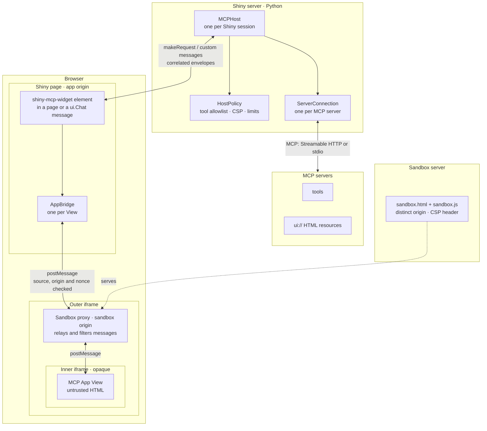

# shiny-mcp-host

**Interactive MCP tools, inside Shiny.**

Render [MCP Apps](https://github.com/modelcontextprotocol/ext-apps) in Python
Shiny pages and chat messages. Write Python; the host handles connections,
rendering, and sandboxing.


## Try it

You need [uv](https://docs.astral.sh/uv/). No Node: the browser code ships prebuilt in the package.

```bash
git clone https://github.com/mattmalcher/mcp-app-shiny.git
cd mcp-app-shiny
make setup   # Python environment from uv.lock
make demo
```

`make demo` starts three things and tells you where they are:

| | | |
|---|---|---|
| MCP server | `http://127.0.0.1:3001/mcp` | the sales explorer example (`examples/sales_explorer/server.py`) |
| Sandbox | `http://localhost:8765` | serves the iframe the app's HTML runs in, on its own origin |
| Shiny app | **`http://127.0.0.1:8000`** | open this |

Then:

1. Ask *"Explore Q3 sales in the West"*. The explorer appears in the reply.
2. Change the product filter. The explorer queries the MCP server through Python.
3. Click a region. The sidebar shows the selection Python received.
4. Click **Ask about this region**. The question lands in the chat and Python answers from the selection.

Ctrl+C stops everything. `make demo-clock` runs the official ext-apps "Get
Server Time" app instead, unmodified, as a compatibility smoke test; that one
needs Node (`make setup-node`), because the official server is an npm package.

## Use it in your app

The package isn't on PyPI yet: install from a checkout with
`pip install path/to/mcp-app-shiny` (or `make build` and install `dist/*.whl`).

Planning to deploy? The sandbox needs **its own hostname**, separate from your
Shiny app's. Check that first: see [Deploying](#deploying).

### In a chat, with your own agent loop

When your agent (or LLM) has already called the tool, render the result you
have. The tool is not called again, so side effects never run twice.

```python
from shiny import App, ui
from shiny_mcp_host import MCPHost
from shiny_mcp_host.sandbox import start_sandbox_server

sandbox = start_sandbox_server(port=8765)  # dev only; see "Deploying"

app_ui = ui.page_fillable(ui.chat_ui("chat"))

def server(input, output, session):
    chat = ui.Chat("chat", history=False)
    host = MCPHost(session, sandbox_url=sandbox.url)
    host.add_server("sales", url="http://127.0.0.1:3001/mcp")

    @chat.on_user_submit
    async def _(text: str):
        args = {"quarter": "Q3"}                                   # your LLM picks these
        result = await host.call_tool("sales", "explore_sales", args)
        await host.render_in_chat(chat, "sales", "explore_sales", args, result=result)

app = App(app_ui, server)
```

Outside chat, put `mcp_widget("sales")` in your UI and call
`await host.render_result("sales", "explore_sales", args, result, target="sales")`.
If nothing else calls the tool, `await host.call_and_render(server, tool, args, target=...)`
does both steps.

### Getting data back from the app

```python
@host.on_model_context            # the app shares state (e.g. a selection)
def _(event):
    print(event.widget_id, event.structured_content)

@host.on_message                  # the app asks to add a message to the conversation
def _(event):
    print(event.text)             # return False to reject it

host.model_context("sales")       # reactive: the latest context from one widget
```

The full example is [`examples/sales_explorer/`](examples/sales_explorer/).

## Write your own MCP App in Python

An MCP App is a tool plus a `ui://` HTML page. Write the server with the
official Python SDK, and the page with `app_html()`, which inlines the official
MCP Apps JavaScript SDK (bundled with this package) as `McpApps`. No Node, no
build step.

```python
from mcp.server.apps import Apps
from mcp.server.mcpserver import MCPServer
from shiny_mcp_host.view import app_html

apps = Apps()

@apps.tool(resource_uri="ui://hello/view.html", description="Say hello.")
def hello(name: str = "world") -> str:
    return f"Hello, {name}!"

apps.add_html_resource("ui://hello/view.html", app_html(
    body='<h1 id="greeting">…</h1>',
    script="""
        const app = new McpApps.App({name: "Hello", version: "1.0.0"});
        app.ontoolresult = (r) => { greeting.textContent = r.content[0].text; };
        app.connect();
    """,
))
mcp = MCPServer("hello", extensions=[apps])   # mcp.run("streamable-http")
```

[`examples/sales_explorer/`](examples/sales_explorer/) is a fuller example.

## API

| | |
|---|---|
| `mcp_widget(id, *, host="mcp", height=360)` | Mount point for an app; works in static UI, dynamic UI and chat messages |
| `MCPHost(session=None, *, id="mcp", sandbox_url=None, policy=None, theme="light")` | One per session; `sandbox_url` falls back to `$SHINY_MCP_SANDBOX_URL` |
| `host.add_server(name, *, url=None, transport="streamable_http", command=None, args=(), env=None, headers=None, auth=None)` | Register a server (connects lazily); `transport="stdio"` launches a subprocess |
| `await host.list_tools(server)` | Tools, with `has_ui`, `ui_resource_uri` and `visibility` |
| `await host.call_tool(server, tool, arguments)` | Plain tool call, e.g. from your agent loop |
| `await host.render_result(server, tool, arguments, result, *, target, error=None)` | Render the app for a call that already happened |
| `await host.call_and_render(server, tool, arguments, *, target)` | Call the tool, then render it |
| `await host.render_in_chat(chat, server, tool, arguments, *, result=None, text=None)` | Append an assistant message with a new widget and render into it |
| `host.widget(id=None, *, height=360)` | A widget tag bound to this host (auto id) |
| `host.on_model_context(fn)`, `host.model_context(target=None)` | Context shared by apps, per widget |
| `host.on_message(fn)` | Messages apps ask to add to the conversation |
| `host.widget_status(target)` | Reactive lifecycle status |
| `await host.remove_widget(target)`, `await host.close()` | Teardown; `close()` also runs when the session ends |

Render errors (server down, bad resource, timeout) appear in the widget and in
`RenderResult.error`; they are not raised. If you render into a widget again,
the newest render wins, even when an older call finishes later.

## Security model

An MCP App is HTML from a third-party server, so it is treated as untrusted:

- **It runs in a sandbox on another origin.** The app's HTML is loaded two
  iframes deep, behind a proxy served from a separate origin, with the spec's
  restrictive Content Security Policy (no network access unless approved). It
  can't read the Shiny page, its cookies, or Shiny inputs. Without a separate
  origin configured, the host refuses to render rather than fall back to
  something unsafe.
- **Python decides what the app may do.** Every tool call from the app goes
  through Python and `HostPolicy`. By default an app may call only its own tool
  and tools its server marks as callable by apps (`visibility: ["app"]`), only on
  its own server. Rejected calls never reach the MCP server.
- **Credentials stay in Python.** Server URLs, headers and tokens never reach
  the browser.

`HostPolicy` options: `app_tools` (explicit allowlist), `allowed_csp_domains`,
`allowed_permissions` (camera, microphone, geolocation, clipboard),
`allow_open_links`, size limits and `request_timeout`. The browser test suite
includes a deliberately malicious app; see [`tests/e2e/test_security.py`](tests/e2e/test_security.py).

## How it works



Python owns the MCP connections; the browser only relays validated requests
from the app to it. The app runs on an origin separate from the Shiny page. For
message formats, supported MCP Apps features and versions, see
[docs/protocol-contract.md](docs/protocol-contract.md). Implements MCP Apps spec
`2026-01-26` using the official `@modelcontextprotocol/ext-apps` bridge (2.0.3).

## Deploying

> **You need two hostnames.** The sandbox the apps run in must be served from a
> different origin than your Shiny app. A different path on the same server is
> not a different origin, so `https://connect.example.com/content/sandbox/`
> next to `https://connect.example.com/content/my-app/` does **not** work. In
> practice this means a second DNS name, such as
> `https://mcp-sandbox.example.com`. It can point at the same server.
>
> It's a second **name**, not a second server, and a second piece of content
> alone isn't enough: browsers draw their security boundary at the origin
> (scheme + hostname + port), and paths like `/content/<guid>/` aren't part of
> it. Two content items on one hostname can read each other's pages and the
> user's login cookie, which is what the sandbox exists to prevent.

The MCP server and the Shiny app have no such requirement: they can live
anywhere, including side by side on one server. Only the sandbox needs its
own hostname, because it's what keeps third-party app HTML away from your
Shiny page's DOM, cookies and inputs. Without it the host refuses to render
rather than fall back to something unsafe.

### Local development

`start_sandbox_server(port=8765)` runs the sandbox in a background thread at
`http://localhost:8765`. Open the app at `127.0.0.1`, so the two also differ
by hostname (browsers share cookies across ports). If the port is taken by
something else, it fails with a message saying so. `make demo` does all of
this for you. Don't use `start_sandbox_server` in production: it serves on the
server's own `localhost`, which users' browsers can't reach.

### Posit Connect

Everything on one Connect server shares one origin, so a single Connect
server can host the sandbox only if it is also reachable under a **second
hostname**. The setup is three content items on the same server, with users'
browsers reaching the sandbox through the second name:

| Content | Reached at |
|---|---|
| Shiny app | `https://connect.example.com/content/<app-guid>/` |
| Sandbox | `https://connect-sandbox.example.com/content/<sandbox-guid>/sandbox.html` |
| MCP server | anywhere; only the Shiny app's Python process talks to it |

The second hostname is a DNS alias for the same Connect server (for example
`connect-sandbox.example.com` next to `connect.example.com`), with a TLS
certificate covering it. Setting that up is a job for your Connect / IT
administrator. Ask for:

- a DNS name pointing at the Connect server, and
- that name added to the server's TLS certificate (or a certificate for it on
  the proxy in front of Connect).

Then:

1. **Deploy the sandbox** as a Python API. Create a directory with this
   `app.py` (plus a `requirements.txt` listing `shiny-mcp-host`):

   ```python
   from shiny_mcp_host.sandbox import sandbox_app

   # The origin your Shiny app is served from (as users' browsers see it).
   app = sandbox_app(allowed_host_origins=["https://connect.example.com"])
   ```

   Deploy it as an ASGI API (for example `rsconnect deploy fastapi`, which
   accepts any ASGI app) and set its access to **Anyone, no login required**.
   It serves only a static proxy page and script, holds no data, and
   logins on the main hostname don't carry over to the alias.
2. **Deploy the MCP server** wherever you like, including as another Connect
   API. Only the Shiny app's Python process talks to it, so the alias doesn't
   matter here. If it requires a Connect login, pass an API key:
   `host.add_server("sales", url=".../mcp", headers={"Authorization": "Key …"})`.
   The key stays in Python.

   To try this with the sales explorer, `make demo-server-bundle` (or the
   `sales-explorer-mcp-server` artifact of a CI run) gives a self-contained
   folder that needs only `mcp`. Deploy it with entry point `server:app`, for
   example `rsconnect deploy fastapi --entrypoint server:app dist/sales-explorer-mcp-server/`.
   Its endpoint is `<content URL>/mcp`; set `MCP_ALLOWED_HOSTS` on the content
   to your Connect hostname to turn on the MCP SDK's DNS-rebinding protection.
3. **Deploy the Shiny app** with the sandbox's URL **on the alias**, for
   example as an environment variable on the content:
   `SHINY_MCP_SANDBOX_URL=https://connect-sandbox.example.com/content/<sandbox-guid>/sandbox.html`.
   `MCPHost` reads it when `sandbox_url` isn't passed.

Not yet verified on a real Connect server:

- that Connect serves content normally when reached through the alias (some
  configurations redirect to the main address);
- that Connect doesn't add its own `X-Frame-Options` or `frame-ancestors`
  header to the sandbox's responses. If it does, browsers block the embed and
  the widget reports *"Sandbox proxy … did not respond"*; your administrator
  can allow embedding.

If a second hostname isn't possible, see the opaque-origin alternative
described in [docs/protocol-contract.md](docs/protocol-contract.md#without-a-second-hostname).
It is not implemented yet.

### Other platforms

Serve `shiny_mcp_host.sandbox.sandbox_app(allowed_host_origins=["https://app.example.com"])`
with any ASGI server on its own hostname over HTTPS, and pass
`sandbox_url="https://sandbox.example.com/sandbox.html"`. An HTTPS app
requires an HTTPS sandbox, and the sandbox only lets the listed origins embed it.

### Transports

Streamable HTTP (`url=`) and stdio (`transport="stdio"`). For authenticated
servers pass `headers=` or an `httpx2.Auth` as `auth=`; OAuth flows are not
built in.

## Limitations

- No LLM included: you choose which tool to call, or connect your own model.
- Inline display only: no fullscreen, streamed partial tool input, file
  download, sampling, or theme changes after an app loads.
- Widgets last as long as the Shiny session; chat history restore isn't
  supported (use `ui.Chat(history=False)`).
- Tested on Chromium. Firefox is wired into the test harness (`E2E_BROWSER=firefox`) but untested.

## Debugging

- Browser console: `[shiny-mcp-host]` (adapter) and `[shiny-mcp sandbox]`.
- Widget state is on the element: `data-state` (`mounting`, `loading`,
  `ready`, `error`, `fallback`, `disconnected`) and `data-error-code`.
- Python logs to the `shiny_mcp_host` logger.

## Development

```bash
make setup-dev         # setup + Playwright Chromium (no Node)
make setup-node        # npm ci + browser builds (needs Node 20+)
make build             # browser bundle + wheel/sdist into dist/
make vendor-sdk        # update the bundled MCP Apps SDK from npm (Python only)
make test              # everything below, plus lint
make test-unit         # pytest unit + Vitest
make test-integration  # Python host against real MCP servers
make test-e2e          # Shiny apps in Playwright (Chromium)
make test-security     # every test marked `security`
make test-compat       # same official app in the upstream ext-apps basic-host
make test-dist         # install the wheel in a clean venv and check it
```

Node is only needed to change the host's TypeScript (`frontend/`, whose builds
are committed to `src/shiny_mcp_host/static/`), for Vitest and lint's type
check, and for the tests that run the official npm demo server or upstream
basic-host. Without it, `make setup-dev` is enough for the pytest suites: the
official-server tests skip (set `REQUIRE_OFFICIAL=1` to make them fail instead).

Layout: `src/shiny_mcp_host/` (package; `static/` holds the compiled bundle and
the vendored SDK), `frontend/` (TypeScript), `examples/`, `tests/`, `docs/`.
