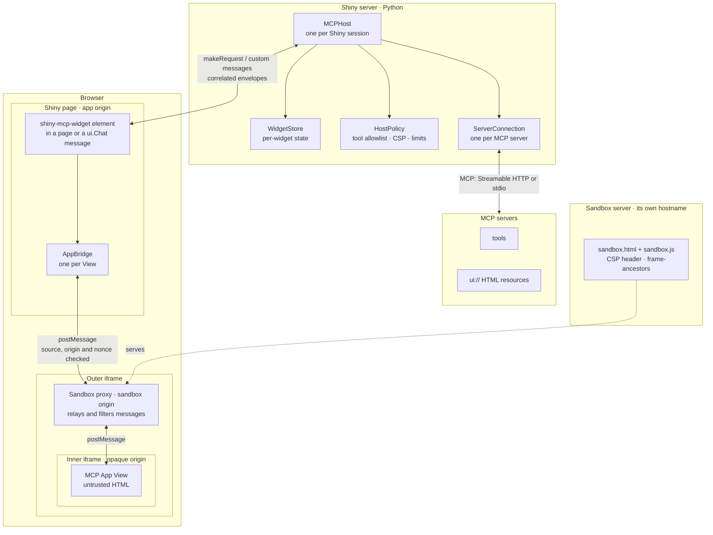

# Architecture and security model

## The pieces

Python owns every MCP connection and every credential. The browser runs the
official `@modelcontextprotocol/ext-apps` `AppBridge` (one per View) and only
relays the View's requests to Python, where they are authorised. Message
formats, supported MCP Apps features and pinned versions are in
[protocol-contract.md](protocol-contract.md).

## Who owns what in Python

- **`MCPHost`** (`host.py`) is the public coordinator: server registration,
  executing and rendering, the browser RPC (`_dispatch`), policy checks on View
  requests, and your callbacks.
- **`WidgetStore`** (`_widgets.py`) owns per-widget state: the widget records,
  the ordering of renders (each render gets a token; only the newest may
  publish), and the two reactive views of that state, `widget_status()` and
  `model_context()`. Creating, updating and removing a widget's record,
  status and context happen there together, so they cannot drift apart. It
  never sends messages; the host decides when state changes and tells the
  browser.
- **`ServerConnection`** (`client.py`) wraps one `mcp.Client` with timeouts
  and error mapping. **`HostPolicy`** (`policy.py`) holds the authorisation
  rules. **`protocol.py`** validates browser envelopes and UI resources.

## Render lifecycle

1. A render call numbers the render for its widget and publishes `loading`.
2. `call_and_render` runs the tool while fetching the `ui://` resource;
   `render_result` / `render_in_chat` skip straight to the resource with the
   outcome they were given.
3. Python validates the resource (one item, matching URI, MIME type, size)
   and filters its CSP and permissions through `HostPolicy`.
4. The outcome is published only if the render is still the widget's newest
   and the widget still exists; otherwise it is dropped (`superseded`).
5. The browser loads the sandbox proxy, waits for its nonce-bound ready
   signal, connects the `AppBridge`, sends the HTML, waits for the View's
   `initialized`, then sends tool input and result (or cancellation) once
   each. It then reports `initialized` to Python (`widget_status`).

Re-rendering, unmounting, `remove_widget` and session end cancel the
widget's in-flight View requests and settle them in the browser.

## Security model

An MCP App is HTML from a third-party server, so it is treated as untrusted.

- **It runs in a sandbox on another origin.** The View is loaded two iframes
  deep: an outer proxy served from a separate origin, and an inner iframe
  without `allow-same-origin` (an opaque origin). The sandbox server sends the
  spec's restrictive Content Security Policy as an HTTP header (no network
  access unless approved) and `frame-ancestors` limited to your app's origin.
  The View cannot read the Shiny page, its cookies, storage or inputs. Without
  a separate origin configured the host refuses to render, in Python and again
  in the browser, rather than fall back to something unsafe.
- **Python decides what the app may do.** Every tool call or resource read
  from a View goes through Python and `HostPolicy`. By default a View may call
  only its own tool and tools its server marks as callable by apps
  (`visibility: ["app"]`), only on its own server. Rejected calls never reach
  the MCP server.
- **Credentials stay in Python.** Server URLs, headers and tokens never reach
  the browser.
- **The browser checks every message.** The host accepts the proxy only
  after a ready message carrying a per-mount nonce from the expected window
  and origin; its transport checks the source window and origin of every
  message and posts with an explicit target origin. The proxy drops sandbox
  control messages coming from the View.

The browser test suite includes a deliberately malicious View that attacks
the host from inside the sandbox (`tests/e2e/test_security.py`); unit and
integration tests cover the Python-side rules (`make test-security`).

### Why the sandbox needs its own hostname

Browsers draw the security boundary at the origin (scheme + hostname + port).
Paths such as `/content/<guid>/` are not part of it, so two content items on
one hostname can read each other's pages and share the user's login cookie.
Cookies are not isolated by port either, so production needs a second
**hostname** (a DNS alias of the same server is enough). See
[deployment.md](deployment.md).

A design for deployments that cannot get a second hostname (an opaque-origin
proxy built from inline HTML) is recorded in
[protocol-contract.md](protocol-contract.md#without-a-second-hostname). It is
not implemented: it departs from the spec and weakens some guarantees.
